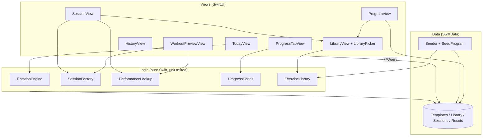
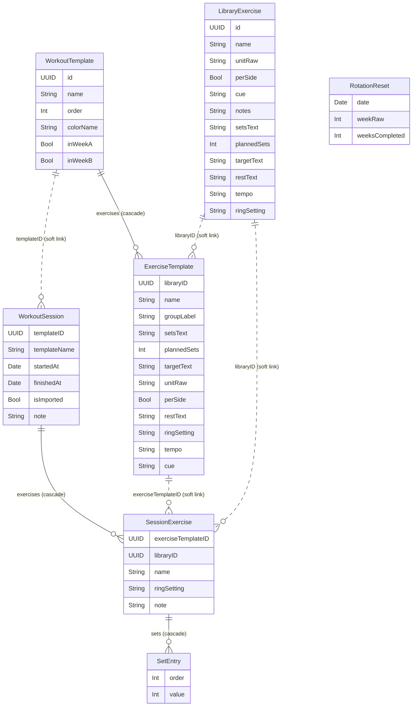
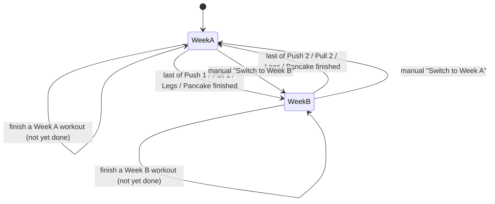
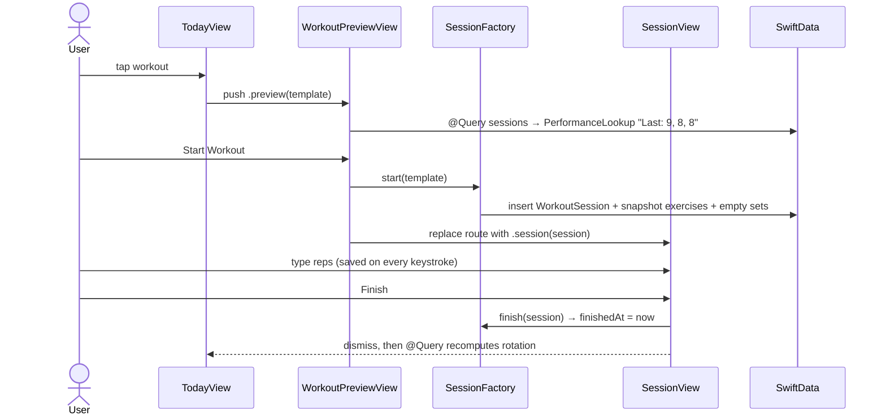
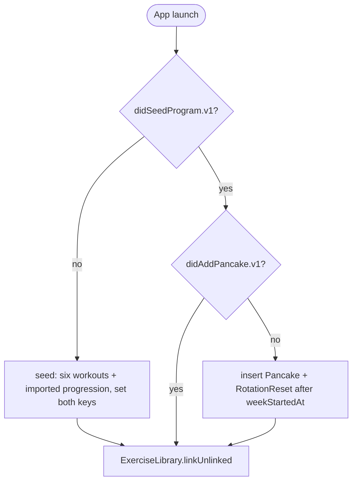

# Architecture

SwiftUI + SwiftData, iOS 18, Swift 6 with main-actor default isolation. No third-party dependencies.

```
WorkoutTracker/
  App/      WorkoutTrackerApp.swift   container, seeding, tab bar
  Models/   Models.swift              SwiftData @Model types
  Logic/    RotationEngine.swift      pure A/B week rotation
            SessionLogic.swift        start/finish sessions, add/swap/remove exercises, last performance, progress series, formatting
            ExerciseLibrary.swift     link exercises to the library, rename sync, add to program
  Seed/     SeedProgram.swift         Notion program data, progression parser, seeder
  Views/    Today, WorkoutPreview, Session, History, ProgressTab, Program, Library, Theme
WorkoutTrackerTests/                  Swift Testing: rotation, seed, sessions, progress, library, Pancake upgrade
WorkoutTrackerUITests/                XCUITest: end-to-end flow, session editing, appearance, screenshot capture
```

## Layers



Views read data with `@Query` and pass plain arrays into the logic types. The logic types never
fetch, so they can be tested with in-memory containers or plain values.

## Data model



Design decisions:

- **Snapshots, not references.** A session copies each exercise's name and prescription when it
  starts. Editing or deleting a workout in the Program tab never rewrites history. The link back
  (`templateID`, `exerciseTemplateID`) is a soft UUID used only for "last time" lookups and rotation.
- **Prescriptions stay as written.** `setsText` / `targetText` / `restText` are strings (`"3-4"`,
  `"2:00-3:00"`, `"Self directed"`) so every Notion cell fits. `plannedSets` (the lower bound of
  the sets range) is the only number derived from them; it sets how many rows a new session starts with.
- **`SetEntry.value == nil`** means "not logged yet". Empty rows are ignored by history and charts.
- **One library entry per exercise.** `LibraryExercise` owns the name, unit and per-side, and
  holds a default prescription. Program slots and logged exercises link to it with a soft
  `libraryID`. Renaming in the library is synced onto program slots; sessions keep their snapshot
  name but still chart together, because `ProgressSeries` groups by `libraryID`.
- **Session edits stay in the session.** Adding, swapping or removing an exercise mid-workout
  changes only that `WorkoutSession`. A swapped exercise takes the library defaults, keeps its
  slot (order, group label), drops `exerciseTemplateID`, and gets fresh set rows. "Last time"
  then comes from the library exercise's history.

## Week rotation

The current week is **never stored**. It's recomputed from history every time, so deleting or
editing a session always gives a consistent answer.



`RotationEngine.state(for:)` folds over events sorted by date:

| Event | Effect |
|-------|--------|
| Finished, non-imported session of a workout in the current week, not yet done | mark done; if the week is complete → flip week, clear done |
| Finished session not in the current week, or a repeat | ignored (still in History) |
| `RotationReset(week, weeksCompleted?)` | jump to that week with nothing done; optionally restart the week count |
| Imported or unfinished session | not an event |

Legs and Pancake are in both weeks, and each week needs its own session of each.
`RotationState.weekStartedAt` records the event that began the current week.

## Logging a workout



An unfinished session appears under **In progress** on Today, so closing the app mid-workout loses nothing.

## Seeding

`Seeder.prepare` runs at every launch:



The seed inserts the six workouts from `SeedProgram` and turns each exercise's Notion progression
lines into imported `WorkoutSession`s, one per line index per workout. Push 2 and Legs are the only
workouts with progression data.

Installs from before Pancake get it added once. Because the rotation is replayed with today's
week membership, adding Pancake to both weeks would leave every past week unfinished and jump
back. The upgrade computes the state first and records a `RotationReset` 1 ms after
`weekStartedAt`, carrying `weeksCompleted`, so the current week and what's done in it stay the same.

`linkUnlinked` gives every program and logged exercise without a `libraryID` a library entry,
matching by name (case-insensitive). Program exercises are visited in program order, so the first
slot sets the library defaults.

## Testing

| Suite | Covers |
|-------|--------|
| `RotationEngineTests` | start state, partial weeks, flip after a full week, any order, week start date, reset carrying week count, full cycle, late weeks, off-week and repeat workouts, Legs per week, unsorted events, resets, empty program |
| `AppearanceTests` | System doesn't override, Light/Dark map to colour schemes, stored raw values stay stable |
| `SeedAndSessionTests` | progression parsing, seed matches Notion, week membership, imported sessions (values, order, dates), seed-once, imported sessions not moving rotation, session snapshots, add/remove sets, finish → rotation, last-performance rules, progress merging, formatting |
| `PancakeTests` | Pancake matches Notion, week needs Pancake, upgrade keeps your place (mid-cycle and first week), upgrade runs once and respects deletion |
| `ExerciseLibraryTests` | one entry per name, idempotent linking, defaults from first slot, linking older stores, create dedupes, rename flows to program not history, add/swap/remove in a session, swapped exercise charts with library history |
| `WorkoutFlowUITests` | Today starts on Week A with Pancake; logging Push 1 moves to "1 of 4 done" and shows in History; imported progression is charted |
| `SessionEditingUITests` | swap in a session (shows library history), swap with logged sets asks first, remove + add leaves the program unchanged, create an exercise from the picker |
| `LibraryUITests` | renaming in the library updates the program |
| `AppearanceUITests` | Dark / Light / System change the screen (measured by screenshot brightness); the choice survives a relaunch |
| `ScreenshotTests` | opt-in screen capture (`make screenshots`) |
