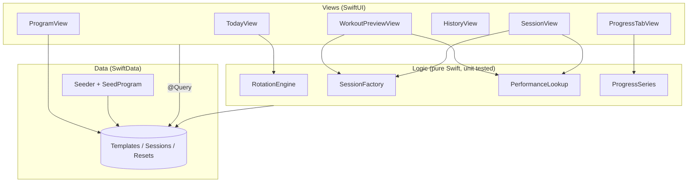
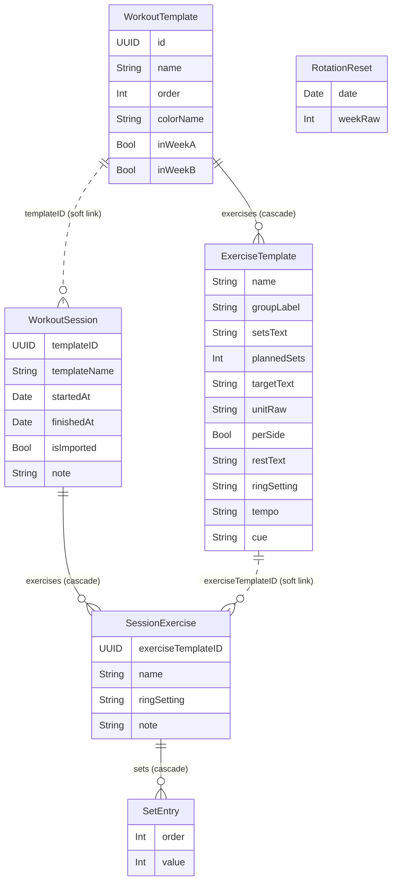
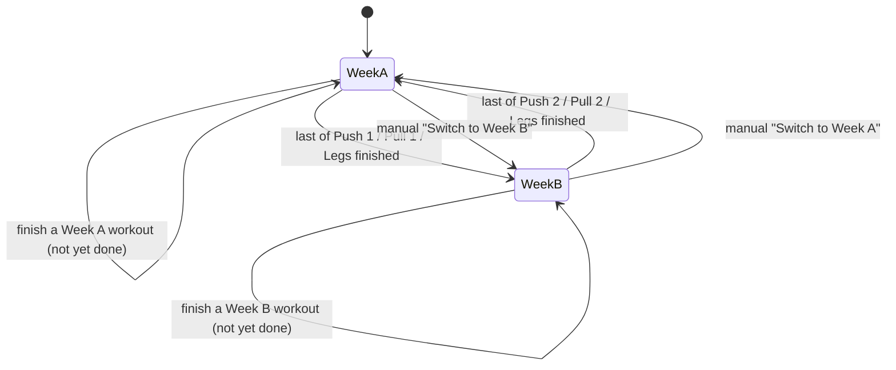
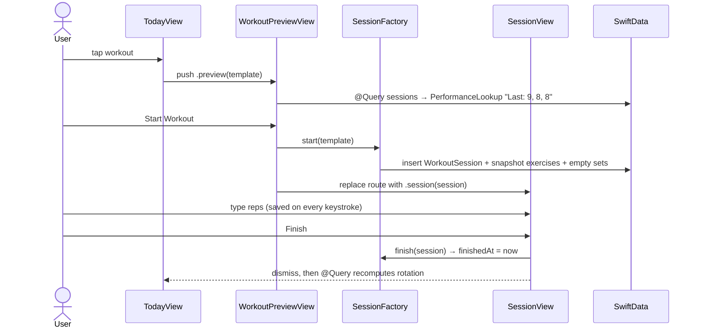

# Architecture

SwiftUI + SwiftData, iOS 18, Swift 6 with main-actor default isolation. No third-party dependencies.

```
WorkoutTracker/
  App/      WorkoutTrackerApp.swift   container, seeding, tab bar
  Models/   Models.swift              SwiftData @Model types
  Logic/    RotationEngine.swift      pure A/B week rotation
            SessionLogic.swift        start/finish sessions, last performance, progress series, formatting
  Seed/     SeedProgram.swift         Notion program data, progression parser, seeder
  Views/    Today, WorkoutPreview, Session, History, ProgressTab, Program, Theme
WorkoutTrackerTests/                  Swift Testing: rotation, seed, sessions, progress
WorkoutTrackerUITests/                XCUITest: end-to-end flow, screenshot capture
```

## Layers



Views read data with `@Query` and pass plain arrays into the logic types. The logic types never
fetch, so they can be tested with in-memory containers or plain values.

## Data model



Design decisions:

- **Snapshots, not references.** A session copies each exercise's name and prescription when it
  starts. Editing or deleting a workout in the Program tab never rewrites history. The link back
  (`templateID`, `exerciseTemplateID`) is a soft UUID used only for "last time" lookups and rotation.
- **Prescriptions stay as written.** `setsText` / `targetText` / `restText` are strings (`"3-4"`,
  `"2:00-3:00"`, `"Self directed"`) so every Notion cell fits. `plannedSets` (the lower bound of
  the sets range) is the only number derived from them; it sets how many rows a new session starts with.
- **`SetEntry.value == nil`** means "not logged yet". Empty rows are ignored by history and charts.

## Week rotation

The current week is **never stored**. It's recomputed from history every time, so deleting or
editing a session always gives a consistent answer.



`RotationEngine.state(for:)` folds over events sorted by date:

| Event | Effect |
|-------|--------|
| Finished, non-imported session of a workout in the current week, not yet done | mark done; if the week is complete → flip week, clear done |
| Finished session not in the current week, or a repeat | ignored (still in History) |
| `RotationReset(week)` | jump to that week with nothing done |
| Imported or unfinished session | not an event |

Legs is in both weeks, and each week needs its own Legs session.

## Logging a workout



An unfinished session appears under **In progress** on Today, so closing the app mid-workout loses nothing.

## Seeding

`Seeder.seedIfNeeded` runs once at launch. It inserts the five workouts from `SeedProgram`
and turns each exercise's Notion progression lines into imported `WorkoutSession`s, one per
line index per workout. Push 2 and Legs are the only workouts with progression data.

## Testing

| Suite | Covers |
|-------|--------|
| `RotationEngineTests` | start state, partial weeks, flip after all three, any order, full cycle, late weeks, off-week and repeat workouts, Legs per week, unsorted events, resets, empty program |
| `SeedAndSessionTests` | progression parsing, seed matches Notion, week membership, imported sessions (values, order, dates), seed-once, imported sessions not moving rotation, session snapshots, add/remove sets, finish → rotation, last-performance rules, progress merging by name, formatting |
| `WorkoutFlowUITests` | Today starts on Week A; logging Push 1 moves to "1 of 3 done" and shows in History; imported progression is charted |
| `ScreenshotTests` | opt-in screen capture (`make screenshots`) |
